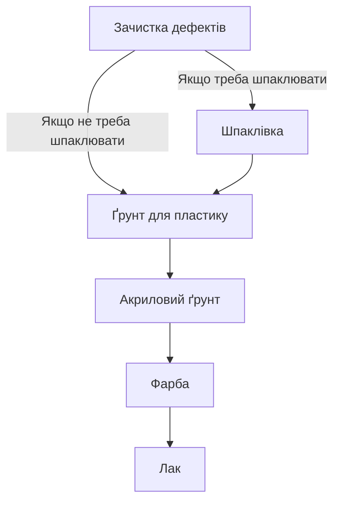
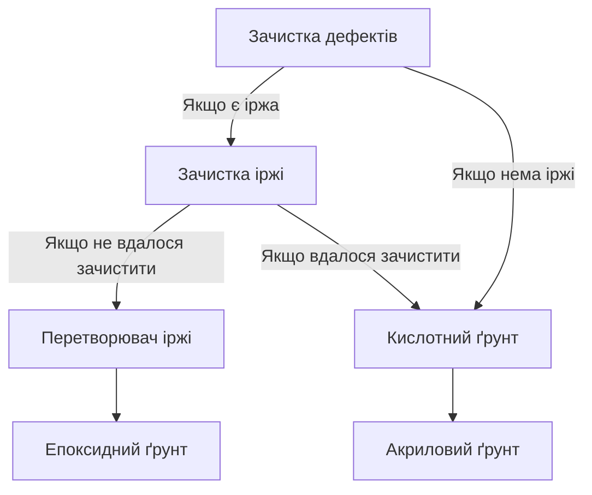
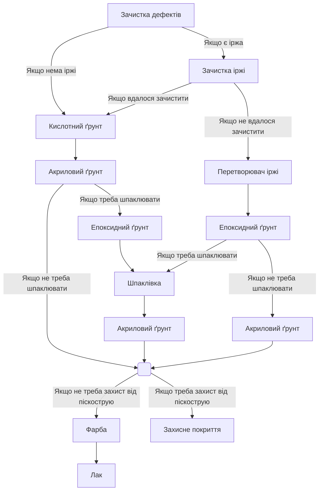
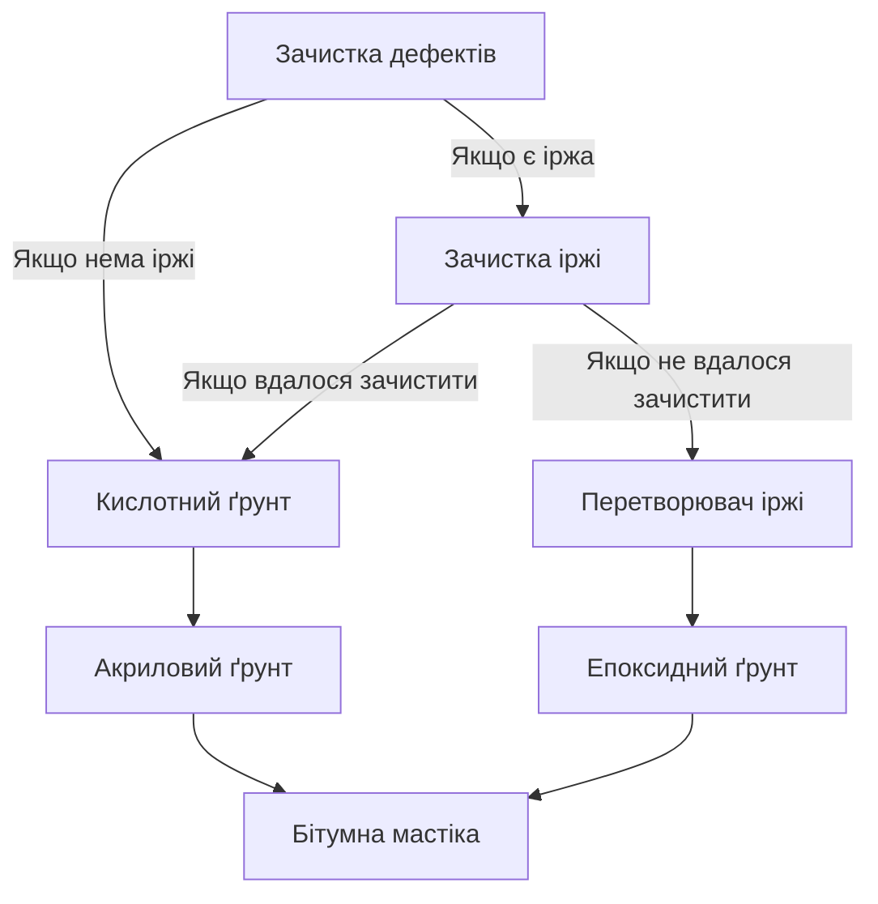

Як же поки що важко жити без [TruthDB](/writings/discourse/103-truthdb), доводиться передивлятися купу інформації в інтернеті, щоб знайти правду. Але я це зробив. В цій статті я опишу найправильніші методи, як фарбувати і захистити від корозії автомобіль. 

# Вимоги до кузова

Не достатньо просто пофарбувати і захистити від корозії автомобіль. Насправді у нас до кузова набагато більше вимог, яких ми можемо не усвідомлювати. 

Всі вимоги до кузова:

* Фарбування. Тут усе просто. Потрібно, щоб кузов був пофарбований і гарно виглядав.
* Захист від корозії. Тут теж усе просто. Потрібно, щоб кузов не іржавів. Стосується тільки металевих частин кузова. 
* Дотик. Потрібно, щоб кузов був приємний на дотик, щоб він не липнув до рук, не бруднив одяг і груз.
* Захист від сонячного випромінення. Фарба може  вицвітати та пошкодитися під впливом сонячного випромінення. Треба зробити додатковий захист від цього.
* Захист від піскострую. Піскоструй - це обстріл кузова камнем, піском, брудом і водою. Такий обстріл виникає від обертання колес і від потоків повітря на великих швидкостях. Піскоструй псує фарбу, антикорозійні засоби і навіть захисти цих засобів. Найбільше страждають нижні частини кузова.

# Частини кузова

Назви всіх частин кузова на малюнках:

    
Багажник, дах, двері, поріг, крила, задній бампер

  

    
Стійки

    
Арки, днище, приховані полості

    
Салон

Метал і пластик - найпопулярніші матеріали кузова. Метал схильний до корозії, пластик схильний до деформації і тріскання на сонці. Спільного у всіх металевих частин кузова є те, що їх всіх треба захистити від корозії. 

# Терміни

* Ґрунт - це покриття, яке наноситься на матеріал перед фарбуванням або нанесенням інших покриттів.
* Шар - це слой покриття, наприклад, ґрунт, фарба, шпаклівка, лак. 
* Праймер - це перший шар, який наноситься на голий матеріал (метал або пластик).
* ЛФП - лакофарбове покриття, загальна назва усіх шарів, нанесених на матеріал.
* База - так називається шар фарби.
* Адгезія - це здатність матеріалів з’єднуватися між собою.
* На суху - це нанесення нового шару на повністю висохший попередній шар.
* Риска - це подряпини, які утворюються на поверхні при шліфуванні. Риску додають для покращої адгезії перед нанесенням нового шару на суху.
* Мокрий по мокрому — це нанесення нового шару на ще не висохлий попередній шар. 
* Вікно адгезії - це проміжок часу, протягом якого можна наносити новий шар мокрий по мокрому.

# Технології

Фарбування і захист від корозії - це дуже пов'язані речі. Фарба наноситься вже на захищену від корозії поверхню. Технологій існує не так багато, куди більше складності в правилах їх застосування. Комбінація різних технології дозволяє досягти бажаних результатів.

Всі технології:

* Зачистка дефектів. Це перше, з чого усе починається. Робимо дефектовку деталі на предмет фізичних ушкоджень, іржі, вздуття, зміни кольору або форми. Виявлені дефекти потрібно механічно зачистити до вцілілого шару або до голого матеріалу.   
* Зачистка іржі. Іржу потрібно механічно видалити до голого металу, наскільки це можливо. 
* Перетворювач іржі. Якщо не вдається видалити іржу повністю, тоді потрібно застосувати перетворювач іржі. Для цього знежирюємо поверхню. Після наносимо перетворювач іржі і дотримуємося його інструкції. Перетворювач іржі шліфувати можна, оскільки після нього буде наноситися праймер, який теж захищає від корозії. 
* Кислотний ґрунт. Кислотний ґрунт є кращим праймером для металу, тому що він захищає від корозії. Кислотний ґрунт можна наносити тільки на чистий голий метал без іржі. Коли метал не є чистим, тоді замість кислотного ґрунта використовують епоксидний ґрунт. На кислотний ґрунт можна наносити тільки акриловий ґрунт, а вже потім усе інше. Кислотний ґрунт не шліфують, замість цього на нього наносять акриловий ґрунт мокрий по мокрому.
* Акриловий ґрунт. Акриловий ґрунт є наповнювачем для вирівнювання поверхності. Акриловий ґрунт єдиний, який можна наносити на кислотний ґрунт. Також акриловий ґрунт можна наносити на епоксидний ґрунт, на ґрунт для пластику, на ЛФП і на шпаклівку. У випадку з пластиком в акриловий ґрунт потрібно додавати пластифікатор. Акриловий ґрунт є найкращим шаром перед нанесенням фарби (бази). Акриловий ґрунт шліфувати можна. Акриловий ґрунт може бути фінальним шаром. Акриловий ґрунт може робити приємною на дотик поверхню. 
* Епоксидний ґрунт. Епоксиодний грунт може бути праймером для металу замість кислотного грунту. Епоксиодний ґрунт захищає від корозії, хоч і гірше за кислотний ґрунт. Епоксиодний ґрунт можна наносити на голий метал з іржею, на ЛФП, на акриловий ґрунт і на шпаклівку. Епоксидний ґрунт є найкращим перед нанесення шпаклівки. Епоксиодний ґрунт шліфувати можна. Епоксиодний ґрунт може бути фінальним шаром. Епоксидний ґрунт може робити приємною на дотик поверхню. 
* Ґрунт для пластику. Ґрунт для пластику є кращим праймером для пластику, тому що він має найкращу адгезію з пластиком. Ґрунт для пластику можна наносити на голий пластик і на шпаклівку. На ґрунт для пластику можна наносити акриловий ґрунт, а вже потім усе інше. Ґрунт для пластику не шліфують, замість цього на нього наносять акриловий ґрунт мокрий по мокрому.
* Шпаклівка. Шпаклівка дозволяє виправити дефекти форми поверхні. Шпаклівка найкраще наноситься на епоксидний ґрунт і на голий пластик. У випадку з пластиком треба використовувати спеціальну шпаклівку для пластику. На шпаклівку зазвичай наносять акриловий ґрунт для виправлення недоліків шпаклівки і вирівнення поверхні. Шпаклівку шліфувати можна. 
* Фарба. Фарба найкраще наноситься на акриловий ґрунт. У випадку з пластиком треба використовувати спеціальну фарбу для пластику. На фарбу зазвичай наносять лак для захисту фарби.
* Лак. Лак захищає фарбу від пошкоджень, робить поверхню приємною на дотик, захищає від сонячного випромінення. У випадку з пластиком в лак треба додавати пластифікатор. Лак є фінальним шаром.
* Бітумна мастіка. Бітумна мастіка найкраще захищає від піскострую. Бітумна мастіка найкраще наноситься на епоксидний і акриловий ґрунти. Бітумна мастіка є фінальним шаром.
* Захисне покриття. Захисне покриття захищає від піскострую, хоч і гірше за бітумну містіку. Захисне покриття змішується з фарбою і використовується замість неї. Захисне покриття робить поверхню приємною на дотик, захищає від сонячного випромінення. Захисне покриття найкраще наноситься на епоксидний і акриловий ґрунти. Захисне покриття є фінальним шаром.
* Пушсало. Пушсало найкраще підходить для антикорозійного захисту прихованих полостей.
* Бризговики. Бризговики захищають крила і пороги від піскострую. Це прибирає необходність захищати ці частини кузова якось інакше. 
* Підкрилки. Підкрилки - це єдине, що може повністю захистити арки від піскострую. Деяки підкрилки мають в собі вбудовані бризговики.

# Пластикові частини кузова

Пластиковими можуть бути крила, пороги, бампера. Ці частини кузова треба пофарбувати і захистити від сонячного випромінення. Підійте такий алгоритм:

Лак зробить приємну на дотик поверхню і захистить фарбу від механічних пошкоджень і від сонячного випромінення.

# Приховані полості

Приховані полості - двері (зсередини), пороги (зсередини), днище (лонжерони). Доступ до цих частин кузова є дуже обмеженим, тож з ними працюють особливо. Приховані полості треба захистит від корозії, наскільки це можливо. 

Змішуємо пушсало з розчинником, нагріваємо до рідкої консистенції і розпиляємо це в приховані полості. Нічого краще ми зробити не можемо через обмежений доступ до прихованих полостей.

# Салон

Салон має бути захищений від корозії і приємний на дотик. Фарбувати не обов'язково. Підійте такий алгоритм:

Праймер захистить метал від корозії, а фінальний шар зробить приємну на дотик поверхню.

# Видимі зовнішні частини кузова

Дах, капот, багажник, двері, стійки, бампера, багажник, пороги, крила. Ці частини кузова мають бути пофарбовані, приємні на дотик, захищені від сонячного випромінення та від корозії. Пороги, крила (знизу), двері (знизу) все теж саме, тільки ще треба захистити від піскострую. Підійте такий алгоритм:

Праймер захистить метал від корозії, а інші шари захистять праймер від механічних пошкоджень. Лак зробить приємну на дотик поверхню і захистить фарбу від механічних пошкоджень і від сонячного випромінення. Захисне покриття захистить від піскострую.

Обов'язково встановлюємо бризговики, вони входять в мій список [базового тюнінту автомобіля](/writings/discourse/172-topic). Без бризговиків захисне покриття все одно може не витримати.

# Невидимі зовнішні частини кузова

Днище і арки треба захисти від корозії і від піскострую. Підійте такий алгоритм:

Праймер захистить метал від корозії, а бітумна мастика захистить праймер від пошкоджень.

Обов'язково встановлюємо підкрилки, вони входять в мій список [базового тюнінту автомобіля](/writings/discourse/172-topic). Без підкрилок арки все одно може пошкодити навіть з бітумною мастікою. 

# Інструмент

Якщо треба усе зробити якісно, тоді нам знадобиться весь нижче перелічений інструмент.

* Первинний знежирювач. Вартість 7$ за літр. Очищає від важких забруднень перед нанесенням праймера. 
* Фінішний знежирювач. Вартість ?. Забезпечує ідеально чисту поверхню перед фарбуванням. 
* Водний знежирювач. Вартість 5$ за літр. Використовується для очищення від легких забруднень, таких як пил. 
* Серветка для знежирення. Вартість 1$. Для якісного знежирення.
* Перетворювач іржі. Вартість 3$ за літр. Цей хімічний засіб перетворює іржу на стабільну сполуку запобігаючи подальшому корозійному процесу. 
* Шліфмашина. Вартість 31$. Для шліфування. 
* Набір шліфувальних кругів на липучці P80, P120, P180, P320, P400, P600, P800, P1000. Вартість 48$ за весь набір по 10 штук. Для шліфування шліфмашинкою.
* М'яка підложка для шліфмашини. Вартість 6$. Для шліфування випуклих поверхонь. 
* Пудра контроль. Вартість 21$ за 100 грам. Для контролю шліфування.
* Набір наждачки P80, P120, P180, P320, P400, P600, P800, P1000. Вартість 57$ за весь набір по 10 штук. Для шліфування вручну.
* Компресор. Вартість 240$. Для нанесення шарів, задування пушсала, обдува від пилу.
* Фарбопульт. Вартість 24$. Для нанесення шарів.
* Сито для фарбопульта. Вартість 1$. Для фільтрації фарби, лаку і ґрунтів.
* Кислотний ґрунт. Вартість 9$ за 200 мілілітрів.
* Акриловий ґрунт (двокомпонентний). Вартість 18$ за 1 літр.
* Малярна стрічка. Вартість 3$. Для захисту поверхонь, що не повинні бути пофарбовані.
* Епоксидний ґрунт (двокомпонентний). Вартість 29$ за 800 мілілітрів.
* Шпаклівка зі скловолокном. Вартість 7$ за 1кг. Для заліплювання великих дефектів.
* Шпаклівка універсальна. Вартість 9$ за 1кг. Для заліплювання маленьких дефектів.
* Шпаклівка для пластику. Вартість 11$ за 1кг.
* Шпаклівка для пор. Вартість 5$ за 200 грам. Для заліплювання дуже маленьких дефектів.
* Набір шпателей. Вартість 3$. Для шпаклювання.
* Фарба. Вартість 12$ за 300 мілілітрів.
* Лак. Вартість 25$ за 1 літр.
* Бітумна мастіка. Вартість 9$ за 4кг.
* Захисне покриття. Вартість 34$ за 1 літр.
* Пушсало. Вартість 4$ за 700 грам.
* Шуруповерт. Вартість 36$ за 4кг. Для зачистки дефектів і іржі.
* Набір металевих щіток для дриля. Вартість 3$. Для зачистки дефектів і іржі.
* Набір коралових щіток для дриля. Вартість 14$. Для зачистки дефектів і іржі.
* Набір борфрезів по металу. Вартість 8$. Для зачистки дефектів і іржі.
* Щітка для металу ручна. Вартість 2$. Для зачистки дефектів і іржі.
* Піскоструй. Вартість 36$. Для зачистки дефектів і іржі.
* Кузовной герметик. Вартість 3$. Для герметизації швів на кузові.
* Бронеплівка. Вартість 1$. Для протидії тертя частин кузова між собою.
* Пластифікатор. Вартість 5$ за 250 мілілітрів. Для додавання у лак, фарбу і ґрунт при роботі з пластиком.
* Липка серветка. Вартість 2$. Для видалення пилу з поверхні.

Загалом виходить 732$. Інформація для порівняння: пофарбувати капот коштує 300$. Пару таких капотів і весь інструмент окупиться.

---

_Опубліковано на Discourse: 2024-11-30 02:55:45.297161 UTC_

## Коментарі з Discourse

**gomin1d — 2024-12-02 05:17:29.913652 UTC**

> Переформатував статтю, додав про Захисне покриття.
